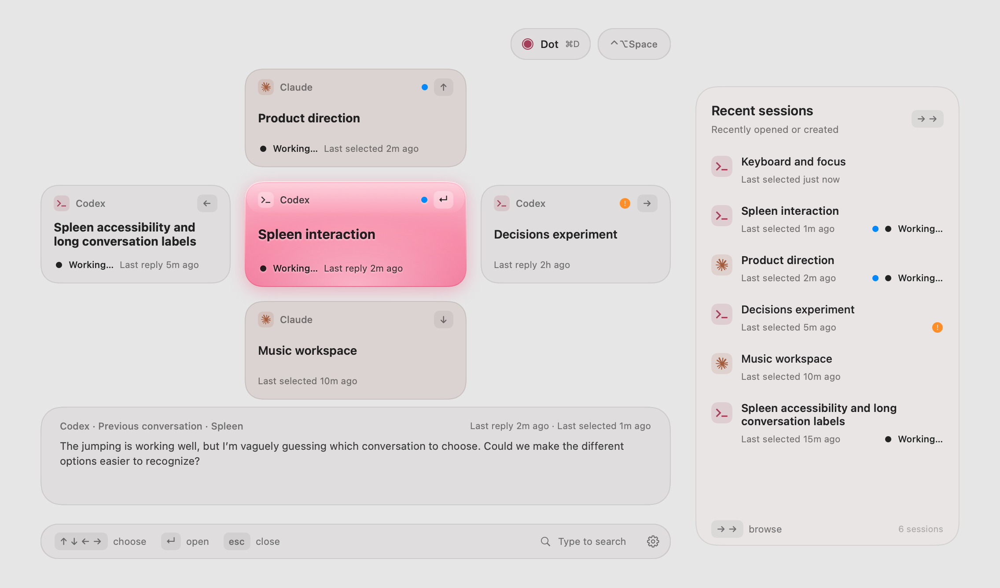

# Spleen

A small native macOS switcher for getting back to the AI conversation you were in.

Press **Control–Option–Space** and a compass appears over whatever you are doing: the conversation you most likely want to return to in the center, four more around it, and a column of recent sessions on the right. Arrow keys pick one, Return opens it in its own app, Escape puts everything back. Typing searches by title, topic or project.

**Works on its own.** Optionally install [Moonshine](https://github.com/d4j3y2k/moonshine) to search open windows and browser tabs alongside your conversations. With both apps installed, **Tab / Shift–Tab** carries the exact query between them, ready to continue typing. Neither app requires the other; each keeps its own result view, permissions, settings, and global shortcut. See [using the apps together](docs/INTEGRATION.md).

Spleen treats a **Codex** thread, a **Claude** chat and a **Claude Code** session inside Claude Desktop as the same kind of thing: a destination you can jump to. It keeps a short local memory to help you return to recent work, and it stays out of the way otherwise. There is no chat window, no composer and no model in the loop by default.

<picture>
  <source media="(prefers-color-scheme: dark)" srcset="docs/assets/compass-dark.png">
  
</picture>

*Native preview with fictional conversations and navigation history enabled, using the fallback material. Live Liquid Glass on macOS 26 is composited by the system.*

> **Status: experimental.** Spleen reads the accessibility trees of two Electron apps to know which conversation is on screen. An update to Claude Desktop or the Codex app can break that overnight. It was built and tested against the app builds current in early November 2026 on macOS 26.

## What it does

- **Compass navigation.** Five fixed positions, so the same key always means the same place. The center starts on the previous distinct conversation, within or across providers, and refines once from local relevance if you have not touched anything yet.
- **Recent sessions.** Press → twice from the center to enter a list of up to 64 sessions from the last 30 days, ordered by recorded selection, observed visit, or Codex creation time. Background replies do not reorder it. To use navigation history for the main compass too, enable **Build compass from recent navigation** in Settings.
- **Search.** Start typing from the compass. Exact and prefix title matches first, then topic and project matches, including provider names.
- **Pins and labels.** Pin a conversation to keep it within reach, or give it a label that is easier to recognize than its generated title.
- **Live indicators.** A gently blinking monochrome dot beside **Working…** and slightly bolder titles identify active Codex and Claude Code conversations across the compass, recent sessions, and search. A separate blue dot marks an unread reply, and **Last reply** shows its time where known.
- **Dot.** One fixed shortcut, ⌘D, that opens a conversation you nominate in Settings, outside of ranking.
- **Native look.** An AppKit non-activating panel hosting SwiftUI, Liquid Glass on macOS 26 with a standard material fallback, light and dark palettes, and respect for reduced motion, reduced transparency and increased contrast.

## How it knows where you are

Spleen combines several sources, all local:

| Source | What it provides | Requires |
| --- | --- | --- |
| Its own dispatches | Which conversation you opened through Spleen | Nothing |
| Codex app-server metadata | Thread titles, projects, short recent excerpts | The Codex desktop app |
| Codex lifecycle hooks (optional) | Working events and completed turns | Reviewing and trusting the hooks in Codex |
| Codex Desktop observation (optional) | Which local thread is selected, when exposed by the app | macOS Accessibility permission and a compatible Codex build |
| Claude Desktop observation (optional) | Which Claude chat or Code session is in front, and its last-reply age | macOS Accessibility permission |

The Accessibility observers read route, title, selection and status metadata; they never read message text, screenshots or the clipboard. An observed Claude chat or Codex thread counts as visited only after it has stayed in front for about two seconds, so passing through one on the way to another does not place it in the compass. Spleen still knows which conversation is in front immediately, so opening it right after switching apps keeps the conversation you just left in the center. It also notes which application is in front, by bundle identifier only and never stored, so a conversation is never hidden as "current" while you are in a different app. Separately, Codex's local app-server supplies bounded recent message excerpts for search and recognition. See [docs/CONTEXT_CONTRACT.md](docs/CONTEXT_CONTRACT.md) for what is recorded and for how long.

Claude discovery covers sessions you save or visit while observation is enabled, rather than its full chat catalog. Direct Codex selection tracking is experimental and depends on what the installed app exposes; saved links and Spleen's own selections work independently. Codex working indicators expire after 15 seconds without a fresh hook event, so long silent operations can lose their indicator. See [coverage and limits](docs/LIVE_INDICATORS.md).

## Requirements

- An Apple silicon Mac. Tested on macOS 26; the deployment target is macOS 13, with a fallback material on earlier systems. Earlier macOS versions have not been independently verified.
- Xcode 26 or later, including the macOS 26 SDK, selected as the active developer toolchain. There are no third-party package dependencies.
- The Codex desktop app, Claude Desktop, or both.

The optional Codex hook installer requires Python 3.11 or later. Switching and building the app do not require Python.

## Install

The current setup is a build from source. For a first-run walkthrough, optional API key setup and troubleshooting, see the [setup guide](docs/SETUP.md).

```sh
git clone https://github.com/d4j3y2k/spleen.git
cd spleen
./scripts/install.sh
open "$HOME/Applications/Spleen.app"
```

The installer builds locally, verifies the signature, and copies the app to `~/Applications` without administrator access. Quit Spleen before installing or updating. There is no notarized download yet. The installer does not change Gatekeeper, grant Accessibility permissions, or install Codex hooks.

## Build and run

To build without installing, use `./scripts/build.sh` and open `build/Spleen.app`. For a development store inside the checkout, use `./scripts/run.sh` instead.

Spleen appears in the menu bar. Press **Control–Option–Space** to open it. For a first destination, use **Add conversation…** with a copied chat link, or let local Codex discovery populate the list. No API key is needed for switching, search, or local indicators.

`build.sh` produces `build/Spleen.app` and signs it with the first Developer ID or Apple Development identity in your keychain, falling back to an ad-hoc signature. A stable identity matters: macOS ties the Accessibility grant to the code signature, and an ad-hoc signature changes on every build, which silently revokes the grant. Set `SPLEEN_SIGN_IDENTITY` to choose a certificate, or to `-` for ad-hoc on purpose.

`run.sh` launches the app with its data in `.local-state/` inside the checkout, first quitting a copy of this build that is already running so a fresh build actually starts. Launching the `.app` directly reuses the last data directory. Before a directory has been chosen, it uses `~/Library/Application Support/Spleen/`. An explicit `--data-dir` overrides the remembered directory; quit before switching stores.

To check everything:

```sh
./scripts/test.sh
```

That runs the Swift package tests, rebuilds the app and runs its native self-test, which exercises the real panel, key handling, store migrations and dispatch paths with injected fixtures.

## Setting up observation

Spleen works with no permissions at all. Saved and discovered conversations are searchable, and anything you open through Spleen is remembered. The two observers are opt-in:

1. Open **Settings** from Spleen's menu bar item.
2. Turn on **Remember visited Claude Desktop sessions** and, if you use Codex, **Remember visited Codex Desktop sessions**.
3. Press **Save settings**. macOS asks for Accessibility access the first time; allow it for Spleen.

The Claude card in Settings reports what the observer is doing. "Claude Code selection observed" means it is working. If it says to allow Spleen in Accessibility after a rebuild, the signature changed: remove Spleen from System Settings → Privacy & Security → Accessibility, add `build/Spleen.app` again, and save settings once more.

For Codex working and reply indicators, see [integrations/codex](integrations/codex/README.md). The hooks are metadata only, require Codex's own hook review, and are never installed or trusted by the Spleen app itself.

## Optional Decisions assessment

You can use your own OpenAI API key to assess recent **Codex** conversations. This is off by default; ordinary switching needs no key. Setup does not require editing Spleen's source or using its command-line trial.

1. Create your own [OpenAI API key](https://platform.openai.com/settings/organization/api-keys) with API access and available billing/credits.
2. Save it in a private plain-text file outside the checkout, either as the raw key or as `OPENAI_API_KEY=YOUR_API_KEY_HERE`, replacing the placeholder with your key. Restrict the file to your account with `chmod 600 "/absolute/path/to/key-file"`. The [setup guide](docs/SETUP.md#optional-decisions-assessment) includes the exact file-creation steps.
3. Select a Codex conversation in Spleen, open **Settings → Decisions assessment → Review selected conversation…**, review the outgoing text, and choose your key file to authorize one request.
4. For recurring use, choose **Assess cards on open…**, read the consent dialog and select the same file. Each later opening of the compass assesses the eligible changed Codex cards on screen, up to 100 requests per day. Opening Settings, search or the editor from the menu bar sends nothing. **Pause assessment on open** stops future automatic requests.

The file stays on your Mac; requests use your key directly with OpenAI. Assessment sends bounded message text that can contain private information. Read the privacy details below before enabling it. The [setup guide](docs/SETUP.md#troubleshooting) covers missing messages, key-file permissions and API errors.

## Use with Moonshine

Install [Moonshine](https://github.com/d4j3y2k/moonshine#install) separately and open each app once. Press **Tab / Shift–Tab** in either search to carry the query to the other. Spleen keeps **Control–Option–Space**; Moonshine uses **Control–Option–M**. No shared account, folder, key, or browser pairing code is needed. A missing companion leaves your search available. The receiving app applies its own privacy settings; a transferred search does not trigger Spleen’s assessment-on-open. See the [connection guide](docs/INTEGRATION.md).

## Privacy and local storage

Everything lives in a handful of JSON files in the data directory, which Spleen keeps readable only by your account:

- `destinations.json`: saved labels, targets, pins, shortcut and the Dot link, plus each discovered Codex chat you open through Spleen. Those follow Codex's current title unless you relabel them, and **Clear history** forgets them unless they are pinned.
- `catalog.json` and `relevance.json`: Codex thread metadata, three short excerpts per thread, and a window of up to six recent user and assistant messages per thread, each at most 2,400 characters (a longer message keeps its beginning and its ending), used for search, recognition and the optional assessment below.
- `context.json`: at most 64 recent navigation events, kept for 30 days.
- `context-settings.json`: observation and compass-order preferences.
- `activity-hooks.json`: when enabled, at most 128 lifecycle metadata events, kept for one hour. The optional reports keep their notification forwarder and private backups of your Codex configuration in `~/.codex/spleen-activity/`, outside the data directory.
- `claude-reply-times.json`: observed reply ages, also expiring after 30 days.
- `assessments.json`: cached assessment labels keyed by a hash of the messages they describe. No text.
- `assessment-on-open.json` and `assessment-ledgers/`: created by assessment on open. They hold the consent, the key file's path (never the key), and daily request ledgers containing request fingerprints and times.
- `decision-reviews/`: one-request ledgers created by manually reviewed assessments, independently of assessment on open.

Full transcripts, tool output, reasoning, screen contents and clipboard are never stored. Turning off recent selections in Settings clears the navigation memory, including discovered chats saved only because you opened them, and pauses observation.

Spleen sends no conversation data to a remote service by default. Its optional Decisions assessment sends bounded recent Codex messages to OpenAI using a key file you choose. Settings offers two separate controls: review the exact payload and approve **one request**, or enable **assessment on open** for changed Codex cards in the compass, capped at 100 requests per day across pauses and restarts. The daily cap applies to assessment on open; manual reviews are separately authorized one-request sends. Claude message text is never sent.

Assessment excerpts are not anonymized: they can contain private details or paths from your messages. Automatic assessment skips recognizable secret-like text, but that screening cannot guarantee that sensitive information is removed.

The key is read when you enable assessment and again at launch if that opt-in remains enabled; it stays in memory and is never copied into Spleen's data files. Rejected keys pause assessment on open with a visible status. A separate command-line trial requires an explicit manifest and credential file. See [docs/SESSION_ATTENTION_IMPLEMENTATION.md](docs/SESSION_ATTENTION_IMPLEMENTATION.md) for exactly what is sent and when, and [docs/DECISIONS_TRIAL.md](docs/DECISIONS_TRIAL.md) for the dormant ranking adapter.

## Project layout

- `Sources/SpleenCore`: identity, catalog, relevance, context memory, ranking. Pure Swift with no AppKit dependency, exercised by the package tests.
- `Sources/Spleen`: the AppKit and SwiftUI app, observers, panel controller, CLI diagnostics and the native self-test.
- `Sources/SpleenEvaluation` and `Sources/SpleenReplay`: a headless replay harness for ranking changes against scripted scenarios.
- `integrations/codex`: setup notes and example hook definitions for the optional Codex reports, which `scripts/install-activity-reports.py` installs.
- `docs/`: design notes and verification records, indexed in [docs/README.md](docs/README.md).

If you fork this and change the bundle identifier in `Resources/Info.plist`, expect to grant Accessibility access again: the grant belongs to the identifier and signature together.

## License

[MIT](LICENSE). Provider names and marks identify supported applications and belong to their respective owners; see [third-party notices](THIRD_PARTY_NOTICES.md). Spleen is an independent project.
