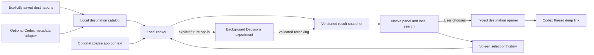

# Architecture

**Desktop slice, 4 November 2026:** `Context.swift` and `ContextRepository.swift` provide provider-qualified identity and bounded provenance-aware interaction memory. `ClaudeDesktopObserver` is an explicit opt-in AX metadata producer; `ContextMonitor` reacts to Spleen-owned atomic file changes. Accepted foreground Code observations also supply bounded recently visited candidates, separate from the Codex catalog. A Codex hook helper accepts lifecycle metadata without labeling it viewed context. These producers feed background relevance/optional Decisions snapshots, and the native compass copies ready choices before accepting arrow/Space/Enter input. `ClaudeDesktopCodeTarget` supplies a separate experimental opener for the live-tested Desktop `epitaxy/local_` route. Arrival and dispatch remain separate evidence. [Current implementation and verification](IMPLEMENTATION.md).

**Earlier relevance slice, 3 November 2026:** `Catalog.swift` performs bounded folder discovery and reads small pages of recent conversational turns through the installed app-server. `Relevance.swift` extracts short local notes and builds an immutable, normalized search and relevance snapshot. `AppModel` builds replacements on a utility queue, rejects obsolete generations, and freezes the snapshot for each presentation. Opening copies the ready snapshot; typing searches its in-memory corpus. Pins remain fixed; the last Spleen selection supplies project and topic context. No foreground thread inspection or external inference is used. A counts-only automatic metadata survey is now verified; richer excerpt checks remain Spleen-folder scoped; see [implementation and measurements](IMPLEMENTATION.md).

`LatestSnapshotScheduler` bounds background work to a running build plus the latest pending replacement. Payload construction/response validation also stay on utility queues. Predictions promote at most one unique winner and preserve the local tail. Context file identity filtering suppresses unrelated directory-write reloads. `PreparedContext` builds fresh/neutral snapshots off the opening path; clock checks select a safe cached fallback. Catalog persistence and optional diagnostics are serialized on utility queues. First discovery may populate an empty untouched invocation; existing/typed invocations remain frozen. Refresh respects policy TTL and failure backoff. Native keyboard handling defers to focused management controls.

`Ranking.swift` retains the optional Decisions experiment in isolation. The shipping app supplies no Decisions transport. The component proposals below include historical designs and possible future context/history experiments; they do not all describe the current implementation.

**Historical first-slice update, 2 November 2026:** the first native shell, JSON store, title search, pins, recents, and URI opener are implemented. See [implementation status](IMPLEMENTATION.md) for the exact shipped subset and test limits. Provider, richer ranking, context, and Decisions sections below remain proposals. The current list keeps all saved results scrollable; it does not hard-cap the catalog to five rows.

## Native shell and local core

Use Swift with an AppKit `NSPanel` hosting SwiftUI content. AppKit owns the panel lifecycle, shortcut, focus, display placement, and destination opening; SwiftUI owns the list and search field. Apple's nonactivating panel style supports a panel that does not activate its owning app, but keyboard focus and dismissal still require an explicit prototype. [NSPanel](https://developer.apple.com/documentation/appkit/nspanel), [nonactivatingPanel](https://developer.apple.com/documentation/appkit/nswindow/stylemask-swift.struct/nonactivatingpanel).

Use a menu-bar access point for settings, manual opening, pause, and quit. Register only the chosen shortcut through a suitable macOS hotkey API; evaluate `RegisterEventHotKey` against the installed SDK as one candidate. Do not assume that global event taps or Accessibility permission are necessary. Test keyboard layouts, shortcut collisions, full-screen Spaces, Stage Manager, and multi-monitor behavior before committing to an implementation.

Read-only SDK inspection confirms `RegisterEventHotKey` is declared in the installed Carbon/HIToolbox `CarbonEvents.h`. Its header describes exclusive registration, collision errors, and a non-thread-safe API. Proposed implementation: register/unregister on the main thread, request exclusive registration, and show a conflict instead of falling back silently to an event tap. Header availability is not proof of runtime behavior or permission requirements.

Panel lifecycle proposal: hidden → presented → dispatching or dismissed. On presentation, copy the current result snapshot, capture the prior app transiently, and focus the search field; make the panel key-capable without making it the main window. A repeated hotkey dismisses. Escape and outside focus loss close without opening anything. Hide before URI dispatch and prevent double dispatch. Never reactivate the prior app after a successful selection, or after the user has deliberately switched elsewhere. Test cancellation focus recovery before choosing nonactivating versus ordinary activation behavior; do not treat `.nonactivatingPanel` alone as a complete focus solution.

This is a component plan, not an implementation. Prefer one process initially. A helper or XPC service is justified only by a measured isolation or lifecycle requirement. A CLI subprocess is an optional provider cost, not part of the panel's rendering path.

## Component contracts

| Component | Responsibility | Failure behavior |
| --- | --- | --- |
| DestinationStore | Stable IDs, label, provider, optional project label, typed open target, timestamps, pin/exclusion state | Load last valid snapshot; preserve manually saved entries |
| CandidateProvider | Bounded metadata discovery; reports coverage, freshness, and capability version | Disable provider on incompatible protocol; saved links still work |
| ContextSnapshot | Optional foreground bundle ID captured before opening Spleen; last selected destination | Missing context is normal; never guess an active Codex thread |
| Ranker | Deterministic local ordering; optional validated remote reranking | Local baseline is always available |
| ResultSnapshot | Candidate IDs, generation ID, context hash, provider freshness, ranker version | Reject stale/mismatched remote results |
| PanelController | Immediate display, local search, focus, stable visible selection | Menu-bar fallback if hotkey registration fails |
| DestinationOpener | Allowlisted navigation using typed targets | Show concise failure and retain selection for retry |
| HistoryStore | Bounded local impressions/selections and performance counters | Disable logging without breaking navigation |

Do not persist Codex preview text: the installed schema describes it as usually the first user message. A metadata-only response can therefore still contain sensitive content. Drop unneeded fields immediately; keep a title only for explicitly allowed destinations. Convert full local paths to user-facing project labels where possible.

An atomic JSON store is enough for a small saved-link prototype. Use SQLite once queryable history and provider snapshots justify it. Keep app runtime data in Spleen's own Application Support directory; do not edit Codex databases or private preferences. Add storage migrations before retaining real usage data across versions.

## Ranking

Start with up to two fixed pins and most-recent Spleen selections for the remaining positions; unseen destinations retain saved order. This gives a reproducible cold start without guessed weights. Count accepted dispatches as selection-history events, with known failures excluded, while keeping arrival success explicitly unverified unless manually checked.

In the baseline experiment compare MRU, frequency over the retained 30-day window, and one preregistered blend. A concrete trial blend for unpinned item i is `0.7 × exp(-ageDays(i)/3) + 0.3 × log(1 + count30d(i))/log(1 + maxCount30d)`, with frequency zero when every count is zero and recency zero for never-selected items. Break ties by saved order then stable ID. The weights and decay are proposed starting values, not learned probabilities. Keep pins identical across comparisons. Add transition counts only if enough repeated transitions exist; start without app-context weighting.

Typed search takes precedence over prediction. Start with case-insensitive exact, prefix, and substring title matching; fuzzy matching is deferred until observed misses justify it. Deduplicate on provider, host scope, and technical ID, not title; the first provider accepts only local chats. Exclude explicitly hidden or known-invalid targets from suggestions while retaining them in management for correction. Provider absence alone does not establish that a saved link is invalid.

At invocation, capture the current application before the panel changes focus. Apple's `NSWorkspace.didActivateApplicationNotification` can supply coarse activation events. It does not reveal which conversation, document, or browser tab is active. A Spleen selection is only a last-known destination hint. [Apple notification reference](https://developer.apple.com/documentation/appkit/nsworkspace/didactivateapplicationnotification).

## Background refresh and latency

Render from memory first. Refresh a dirty catalog after a short debounce, on explicit refresh, or at a conservative interval while the user is active. Start with a 30–60 second polling experiment only if a supported provider exists; back off while idle, offline, asleep, or on errors. Do not start a new Codex process on each keypress.

For the saved-link prototype, load once at launch and recompute after edits or selections; there is no polling loop. Capture the candidate IDs and score features before applying the current selection to history. Future inference requires a trigger policy that can actually finish before invocation: first try debounced catalog/selection changes, not a request started when the panel opens. Account for all background requests, including results never used.

Any future model job runs outside the interaction path. Key it by candidate set, relevant context, prompt version, and model. Keep one in-flight job, cancel superseded work when possible, and discard late results whose generation no longer matches. A short deadline limits usefulness; API processing and billing may continue after a client timeout, so do not blindly retry uncertain failures.

Keep ranking results until the next invocation, with a proposed two-minute expiry for context-sensitive reranking. A stale metadata catalog may still support local search but must not masquerade as live activity. On missing or expired remote results, use the deterministic baseline immediately.

## Codex adapter boundary

Opening is a supported URI integration: `codex://threads/<thread-id>` addresses a local chat. Validate the target format; construct the URL from a known ID rather than from model output. Opening a URL successfully means the OS accepted the request, not that the destination was visibly reached. [Official deep-link reference](https://learn.chatgpt.com/docs/app/commands#deep-links).

The Add destination form accepts an existing local-chat URI or technical ID plus an explicit label. Reject reserved `new` routes, queries, fragments, credentials, and other schemes/hosts; build the canonical URI from the parsed ID. Do not add remote-host routing based on undocumented query parameters. A later provider cannot overwrite a user's custom label merely because a thread title changed.

Discovery is a separate provider capability. Use version-matched `thread/list` and `thread/read` only if the connection and data coverage can be demonstrated. Prefer metadata-only reads and `useStateDbOnly: true` for list probes. Never call `thread/resume` just to observe a thread: it changes loaded state and subscriptions. Do not start turns, mutate metadata, install a daemon, or patch app preferences as part of discovery. A fresh app-server process is not evidence of desktop live activity.

Represent status as **unknown** unless the provider's scope and freshness are established. In particular, `notLoaded` is a process/store observation, not proof that the desktop thread has finished. The currently available Codex app tools are agent-side capabilities; their existence does not establish a callable API for an independent Swift app.

## Optional Decisions adapter

Decisions accepts supplied choices and returns a chosen value, option probabilities, and separate confidence. This makes it a possible reranker of an already retrieved shortlist. It cannot discover thread IDs, observe the desktop, or establish intent from unavailable evidence. [Decisions guide](https://developers.openai.com/api/docs/guides/decisions).

For a future opt-in experiment, send 5–10 opaque candidate IDs with short user-approved labels, coarse context, and small numeric recency/frequency features. Include a “none of these” choice. Never send screen captures, clipboard contents, full transcripts, raw file paths, credentials, or employer context. Map returned IDs back to the exact local candidate generation; reject unknown IDs, malformed answers, refusals, and stale responses.

The model probabilities are conditional on the supplied candidate set. Confidence is a separate API field, not demonstrated calibration for this person's future behavior. Treat both as hypotheses to evaluate. Do not expose a “92% likely” UI without calibration evidence.

Define reranking explicitly: order unpinned candidates by returned option probability, with local order breaking ties. Preserve pins and never override typed search. If “none” is the highest-probability option, retain local ordering rather than blanking the panel. The chosen option alone does not specify a full order. Validate the complete candidate mapping and finite probability values; on failure use the local result. These are application policies to test, not API guarantees of ranking quality.

Use deterministic reason labels from known features. Decisions is not an explanation generator. Any future generated summary or explanation would be a separate Responses/Structured Outputs decision with its own justification and data boundary.

No API adapter is enabled at this stage. A future experiment requires separately authorized API access and spending, explicit data choices, a local request/token budget, and an off switch.

